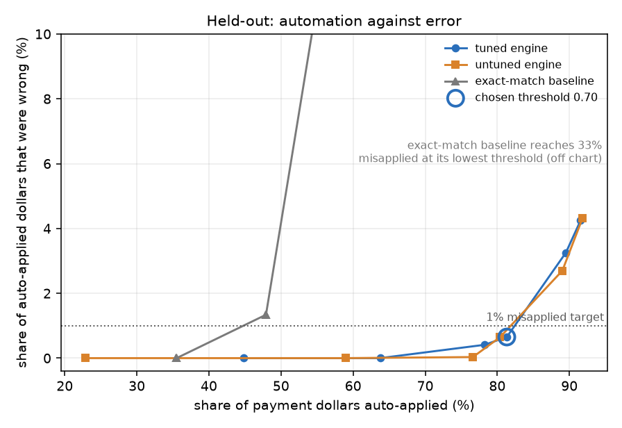
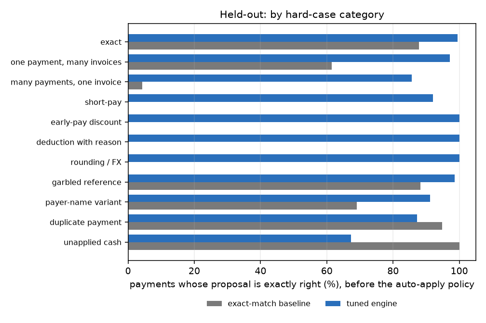
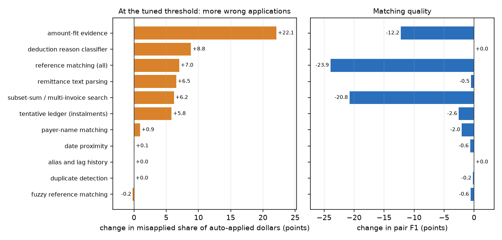

# 💸 Cash Application Engine

Match incoming payments to open invoices when the money does not arrive clean. One payment covers six invoices. Six payments cover one. A customer short-pays and gives a reason code, or does not. The payer's name is abbreviated, the invoice number has a digit swapped, the same payment is presented twice.

This is a matching engine with an explanation for every decision, an auto-apply policy with a measurable error budget, and an evaluation that was set up so the numbers can be believed. It runs on a laptop in pure Python, offline, with no model and no API key.

**Everything here is synthetic.** Customers, invoices, payments and reason codes are generated from a seed. No real company, customer or bank data is used anywhere, and the limits section says what that costs.

## The problem

Cash application is the step in accounts receivable where an incoming payment is attached to the invoice or invoices it pays. When the remittance is clean it is trivial. The work, and the money, is in the rest: the payments a rules engine cannot place go to a person, and every payment applied to the wrong invoice later becomes a collections call to a customer who already paid.

So the number that matters is not "match accuracy". It is a pair: **how many dollars can be applied without a person, and how many of those dollars were applied wrongly.** The engine gives every payment a confidence, a policy turns that into auto-apply or exception queue, and the evaluation reports the trade between the two.

## What is in the pipeline

```
bank payment: payer name, amount, currency, date, reference, memo
   │
   ▼
remittance parser ── rules by default; an optional LLM hook can add references, validated, rules as fallback
   │   references, amounts listed next to them, deduction words, discount, "partial" / "final" / "on account"
   ▼
payer resolution ─── name similarity (rarity-weighted tokens + trigrams) + alias memory from past payments
   │                 + any customer that owns an invoice the references point at
   ▼
hypotheses, per candidate customer: a set of open invoices and how the cash is explained
   ├─ single invoices ............ exact · rounding / FX · early-pay discount · listed deduction · short-pay · partial · overpay
   ├─ subsets of referenced invoices
   └─ exact subset-sum over the customer's open invoices (meet in the middle, bounded) when nothing anchors the payment
   │
   ▼
explainable scoring ─ reference · payer name · amount fit · date proximity · history  →  best hypothesis + margin over the runner-up
   │
   ▼
duplicate check · tentative ledger (so a second instalment sees the balance the first one left)
   │
   ▼
policy ───── confidence at or above the threshold: auto-apply.  Otherwise: exception queue, with a reason.
             Every decision, either way, carries a plain-English explanation.
```

Reference matching has tiers, each with a stated similarity: exact invoice number (1.00), the customer's PO number (0.90), one edit away such as a swapped or dropped digit (0.75), the last 5 or 6 digits only (0.70). An amount printed next to a damaged reference that equals the invoice balance confirms it.

Allocation tolerances are explicit: unanchored multi-invoice sets must sum **to the cent**; a single invoice or a set named by the references may differ by up to one currency unit (customers who round) or 1.5% when the payment is in another currency (FX spread). A difference inside tolerance is written off and classed `fx_rounding`.

Example decision, copied from `python -m cashapp demo` (the remittance names only one of the two invoices; the other is found because the pair sums to the payment exactly):

```
P00095 2025-09-27 'LAKESIDE FOODS LLC' 4,427.20 USD  ref='TRN 883071753' memo='INVS 3634721'
  -> AUTO_APPLY  confidence 0.96
     applies to INV-3634721 (clean), INV-2396879 (clean)
     - Payer 'LAKESIDE FOODS LLC' resolves to Lakeside Foods LLC (name similarity 1.00; this payer string seen 9x before).
     - Reference 3634721 matches INV-3634721 (exact).
     - INV-2396879 is not named in the remittance.
     - Payment 4,427.20 USD equals the open balances of 2 invoices (INV-3634721, INV-2396879) to the cent; no other combination fits.
     - Runner-up: INV-3634721 as overpay (score 0.82); margin 0.13.
     - Confidence 0.96 is at or above the threshold 0.85: auto-apply.
```

## The hard cases the generator produces

Each payment comes from a builder for one category and carries ground truth: exactly which invoices it settles and how.

| Category | What it is |
|---|---|
| exact | one payment, one invoice, clean reference. Includes look-alike pairs (same payer, same amount, different invoices) that must not be mistaken for a duplicate, payments with no usable reference at all, and invoice-plus-prepayment overpayments |
| one payment, many invoices | 2 to 6 invoices; references fully listed, listed without amounts, only some named, or absent |
| many payments, one invoice | 2 or 3 instalments, with and without "partial" / "final" wording, some of equal size |
| short-pay | 1 to 9% short, no reason given |
| early-pay discount | paid inside the discount window for the discounted amount, with and without a note |
| deduction with reason | 2 to 15% short with a reason code or words (pricing, damage, shortage, freight, promo, tax, return), amount listed or not, some codes the engine has never seen |
| rounding / FX | whole-currency-unit rounding, or an invoice in EUR / GBP / CAD paid in USD at a rate off the table by up to 1.2% |
| garbled reference | transposed, dropped or substituted digit, OCR letter, truncation, the PO number instead, and some with two corruptions at once |
| payer-name variant | abbreviations, legal-suffix changes, bank prefixes, truncated fields, typos, initials, first word only; seen or unseen in the customer's history |
| duplicate payment | a re-presented copy of an earlier payment, 1 to 6 days later |
| unapplied cash | a payer that is not a customer, a prepayment, or a repeat payment of an invoice that was settled long ago |

Combinations happen: any category can arrive with a payer-name variant, and a few with a damaged reference.

## How the evaluation is kept honest

Borrowed from the sibling project [rag-tuning-lab](https://github.com/Sup3rMar10/rag-tuning-lab).

- **One split, made once.** Customers are split with a fixed seed into a tuning half and a held-out half. A customer's invoices, history and payments stay on one side. `tune()` is handed the tuning half and nothing else. A test scrambles the held-out ground truth and checks that everything chosen during tuning is unchanged while only the held-out scores move.
- **The engine never reads ground truth.** A test runs it on a dataset with the truth removed and checks the decisions are identical.
- **A stated goal, not a favourite metric.** The policy target is that at most 1% of auto-applied dollars may be misapplied. For any engine or ablation, the threshold is the lowest one that meets that target on the *tuning* half. The held-out half is then scored at that threshold.
- **A named baseline.** A plain matcher that trusts only exact invoice numbers, exact payer names and exact amounts, applies cash without classifying differences, and has no duplicate check or combination search. It gets the same threshold rule.
- **One setting at a time, and ties keep what is there.** A tuned setting changes only if it beats the current one by more than 0.003 of auto-applied dollars. Every configuration tried is in `results/trials.jsonl`.
- **Dollars, with intervals.** Payment amounts are converted to USD at the table rate. The intervals are 95% bootstrap intervals over payments. A few large payments dominate a dollar-weighted rate, so read the interval, not just the point.
- **What "correct" means is written down.** A proposal is correct when it names exactly the invoices the truth settles, the set of non-clean classes matches (discount, `deduction:<REASON>`, short-pay, partial, FX/rounding), and any cash left on account is within one currency unit. For a duplicate or unapplied payment the only correct proposal is none.

<!-- RESULTS:START -->







### Setup

| | |
|---|---|
| Data | synthetic, seed 7: 120 customers, 3,739 open invoices, 1,553 payments |
| Split | by customer, seed 2024, made once. Tuning half: 60 customers, 774 payments. Held-out half: 60 customers, 779 payments |
| Policy target | at most 1% of auto-applied dollars may be misapplied; the threshold is the lowest one that meets this on the tuning half |
| Tuning | 59 configurations tried, written to `results/trials.jsonl` |
| Run time | 327.6 s on one laptop CPU, pure Python |

### Held-out results

The threshold for every row was chosen on the tuning half. Held-out payments were scored after tuning finished.

| System | Threshold | Auto-applied dollars | Misapplied share of auto-applied dollars | Misapplied / auto-applied payments | 1% target met on tuning half | Pair precision | Pair recall | Payments proposed exactly right |
|---|---|---|---|---|---|---|---|---|
| exact-match baseline | 0.61 | 47.9% | 1.34% | 2 / 331 | yes | 99.7% | 74.5% | 54.4% |
| engine, default settings | 0.91 | 50.9% | 0.00% | 0 / 412 | yes | 96.6% | 98.0% | 94.0% |
| engine, tuned | 0.70 | 81.3% | 0.65% | 6 / 616 | yes | 96.7% | 97.7% | 93.8% |

Tuned engine, 95% bootstrap interval over payments: auto-applied dollars 76.5% to 85.7%; misapplied share 0.06% to 1.53%. At the chosen threshold 616 of 779 held-out payments were auto-applied and 6 of those were wrong; 85% of all wrong proposals were sent to the exception queue instead.

### Threshold sweep (tuned engine, held-out)

| Threshold | Auto-applied dollars | Misapplied share of auto-applied dollars | Payments auto-applied |
|---|---|---|---|
| 0.50 | 91.6% | 4.25% | 690 of 779 |
| 0.60 | 89.5% | 3.25% | 664 of 779 |
| 0.70 | 81.3% | 0.65% | 616 of 779 |
| 0.80 | 78.2% | 0.41% | 597 of 779 |
| 0.90 | 63.7% | 0.00% | 477 of 779 |
| 0.95 | 44.8% | 0.00% | 370 of 779 |

### By hard-case category (tuned engine, held-out, at the chosen threshold)

Proposal-correct is before the policy: did the engine name exactly the right invoices and classes (for a duplicate or unapplied payment: nothing).

| Category | Payments | Proposal correct | Baseline proposal correct | Pair F1 | Auto-applied dollars | Misapplied / auto-applied payments |
|---|---|---|---|---|---|---|
| exact | 180 | 99.4% | 87.8% | 1.00 | 97.3% | 0 / 171 |
| one payment, many invoices | 104 | 97.1% | 61.5% | 0.99 | 86.2% | 0 / 90 |
| many payments, one invoice | 70 | 85.7% | 4.3% | 0.95 | 90.6% | 5 / 61 |
| short-pay | 50 | 92.0% | 0.0% | 0.93 | 68.9% | 0 / 37 |
| early-pay discount | 40 | 100.0% | 0.0% | 1.00 | 97.9% | 0 / 37 |
| deduction with reason | 58 | 100.0% | 0.0% | 1.00 | 96.8% | 0 / 56 |
| rounding / FX | 47 | 100.0% | 0.0% | 1.00 | 100.0% | 0 / 47 |
| garbled reference | 68 | 98.5% | 88.2% | 0.99 | 90.1% | 0 / 59 |
| payer-name variant | 68 | 91.2% | 69.1% | 0.94 | 82.8% | 0 / 57 |
| duplicate payment | 39 | 87.2% | 94.9% | n/a | 0.0% | 0 / 0 |
| unapplied cash | 55 | 67.3% | 100.0% | n/a | 0.4% | 1 / 1 |

### Ablations (held-out)

One piece switched off at a time, everything else as tuned. Two views. **Own threshold:** the ablated engine gets its own threshold, chosen on the tuning half by the same rule; a threshold of 1.00 means nothing short of full confidence kept errors inside the 1% budget on the tuning half. **At the tuned threshold:** the ablated engine is scored at the full engine's threshold, which isolates what the piece does to errors.

| Removed | Own threshold | Auto-applied dollars | Misapplied share | At the tuned threshold: auto-applied | At the tuned threshold: misapplied share | Pair F1 | Payments proposed exactly right |
|---|---|---|---|---|---|---|---|
| nothing (tuned engine) | 0.70 | 81.3% | 0.65% | 81.3% | 0.65% | 0.972 | 93.8% |
| payer-name matching | 1.00 | 0.4% | 0.00% | 80.9% | 1.58% | 0.951 | 89.0% |
| tentative ledger (instalments) | 1.00 | 0.4% | 0.00% | 83.6% | 6.49% | 0.946 | 86.9% |
| deduction reason classifier | 0.99 | 11.4% | 0.00% | 81.3% | 9.50% | 0.972 | 86.4% |
| amount-fit evidence | 0.90 | 32.5% | 2.42% | 69.8% | 22.74% | 0.850 | 82.7% |
| subset-sum / multi-invoice search | 0.91 | 32.6% | 0.00% | 47.7% | 6.84% | 0.764 | 78.9% |
| reference matching (all) | 0.90 | 38.2% | 0.88% | 56.9% | 7.66% | 0.732 | 66.5% |
| remittance text parsing | 0.90 | 55.7% | 0.00% | 79.3% | 7.19% | 0.967 | 86.3% |
| fuzzy reference matching | 0.72 | 76.6% | 0.46% | 76.6% | 0.46% | 0.966 | 92.9% |
| alias and lag history | 0.78 | 79.2% | 0.63% | 81.4% | 0.67% | 0.972 | 93.8% |
| date proximity | 0.71 | 80.9% | 0.47% | 81.1% | 0.71% | 0.965 | 93.2% |
| duplicate detection | 0.70 | 81.3% | 0.65% | 81.3% | 0.65% | 0.970 | 93.5% |

Reading the ablations (generated from the table above): at the tuned threshold the misapplied share rises most when these are removed: amount-fit evidence (22.7%), deduction reason classifier (9.5%), reference matching (all) (7.7%), remittance text parsing (7.2%), against 0.65% for the full engine. Removing these made no measurable difference on this data: date proximity, alias and lag history, duplicate detection. A single run on one synthetic dataset cannot separate a small effect from noise, so "no measurable difference" is not "useless".

### Tuned settings

Feature weights: ref 4, name 4, amount 2, date 0.25, history 0. Margin penalty 0.3 over a reference margin of 0.1; payments scoring under 0.4 are treated as having no match.

<!-- RESULTS:END -->

How to read the by-category table: "proposal correct" is measured before the policy. The baseline looks good on duplicates and unapplied cash only because it proposes nothing for them: it cannot place the payment, and for a duplicate its reference points at an invoice that is already closed.

## Run it

Python 3.10 or newer (tested on 3.13). The engine uses only the standard library; the charts need matplotlib and the tests need pytest.

```bash
git clone https://github.com/Sup3rMar10/cash-app-engine.git
cd cash-app-engine
pip install -r requirements.txt

python -m cashapp demo                      # a small synthetic batch, offline, about a second, with explanations
python -m cashapp generate --out data/synth.json
python -m cashapp match --data data/synth.json --threshold 0.85 --out decisions.jsonl
python -m cashapp eval                      # split, tune, score held-out, ablate: writes results/ (about six minutes on a laptop)
python -m cashapp report --write-readme     # rebuild the charts and the results block above from results/summary.json
python -m pytest
```

`eval` is deterministic: re-running it reproduces every number in `results/summary.json` except the run time. `sample/sample_batch.json` and `sample/sample_decisions.jsonl` are a small generated batch and the engine's decisions on it, so you can read the output without running anything. After `eval`, `results/tuned_config.json` can be passed to `match --config`.

Using the pieces from Python, including with your own model for the remittance text:

```python
from cashapp.engine import Config, Engine
from cashapp.policy import apply_policy
from cashapp.remit import LLMRemitParser
from cashapp.schema import Dataset

ds = Dataset.load("sample/sample_batch.json")

def llm(prompt: str) -> str:          # any function from prompt to text; it must return the JSON the prompt asks for
    ...

engine = Engine(ds, Config(), parser=LLMRemitParser(llm))   # omit parser= to use the offline rules
for d in apply_policy(engine.run(), threshold=0.85):
    print(d.payment_id, d.status, d.reason, d.explanation[-1])
```

`LLMRemitParser` validates the reply strictly (fixed reason list, numeric amounts, 4 to 8 digit references) and falls back to the rules on anything else, counting both outcomes. It only ever *adds* references to what the rules found. `cashapp.remit.anthropic_llm()` builds such a function for the Anthropic API. **It is off by default and has never been run against the live API in this repo**: the model path is tested only with fake model functions, including ones that return garbage or raise.

## Limits, stated plainly

- **The data is synthetic, and I wrote both the generator and the engine.** The hard cases are the ones I thought of, in the proportions I chose, and the engine was built by someone who knew them. Real remittances are messier in ways nobody here thought to generate. The numbers show how the engine behaves against these cases and what each piece buys. They are not a forecast of any customer's auto-apply rate.
- **Payments arrive already parsed.** There is no bank-file parsing (BAI2, CAMT.053, MT940), no lockbox images, no emailed remittance PDFs. The input is payer, amount, currency, date, reference and memo.
- **One customer per payment.** A parent company paying for several subsidiaries in one remittance is not handled.
- **FX is a table.** One fixed rate per currency, 1.5% tolerance, no rate-by-date. Exact-sum search over many invoices is not run for foreign-currency payments, since a rate difference breaks exact sums.
- **The combination search is bounded.** At most 6 invoices per set, at most 30 candidate invoices per customer, exact sums only. A real payer with 200 open invoices needs more.
- **Reason codes are a made-up table plus keywords.** Real payers use their own codes, and the mapping is per payer.
- **The tuner switched off alias history and gave date proximity little weight.** On this synthetic data the payer name and the reference carry the signal, so the other two add nothing measurable (see the ablations). Real payers repeat their own strings and pay on their own schedules, so I would expect them to matter more there; this data cannot show it.
- **Hand-set constants.** How much evidence each explanation (exact, discount, listed deduction, short-pay, partial, overpay) deserves was set by hand and not tuned. Only the five feature weights, the margin penalty and reference margin, the no-match floor and the ledger confidence gate were tuned.
- **The sample is small and the dollar-weighted error is noisy.** The held-out half has well under a thousand payments, and a single large payment moves the misapplied rate. The intervals say how much.
- **The tentative ledger is a simplification.** It reduces an invoice's balance when a proposal is confident, whether or not a person has confirmed it.
- **The baseline is simple on purpose.** A production rules engine does more than exact matching. The comparison shows what the extra pieces buy over exact matching, not a ranking against any real product.
- **Pure Python, not tuned for scale.** Hundreds of payments take seconds; millions would need an index and a different search.

## What I would do differently with a real customer

1. **Start from their data and their definition of wrong.** Pull a few months of already-applied cash with the payer strings, remittance text and what finance actually applied, as the gold standard. Agree with the controller what counts as misapplied and what a misapplied dollar costs, because the 1% budget here is a placeholder.
2. **Measure today's auto-apply rate first.** The improvement worth reporting is against what they run now, on their own history, not against my baseline.
3. **Build their tables from history, not from guesses.** Payer-name aliases, reason codes per payer, payment-lag habits and discount terms all exist in their past applications. The alias and lag memory here is that idea in miniature.
4. **Run in shadow mode first.** Decisions are written next to what the team does, nothing is applied, and every disagreement is read. Auto-apply starts on one payer segment with a dollar cap per payment, not everywhere.
5. **Treat corrections as training data.** Each exception a person resolves is a labelled example; the weights, thresholds and alias tables should be refit from them on a schedule, with the same split discipline.
6. **Monitor the error rate you cannot see.** Misapplied cash only shows up later as a dispute. Audit a random sample of auto-applied payments every week and alert on queue age, auto-apply rate by payer, and drift in confidence.
7. **Handle the plumbing.** Idempotent write-back to their ERP, an audit trail of what was proposed and why, a rollback path, handling of period close, and real bank-file formats and real FX rates.
8. **Keep PII and bank data out of any model call**, mask what a hosted model sees, and decide with their security team whether a model parses remittance text at all. The rules path works with no model, and that is the default here.

## Development notes

These are the things that changed after I looked at results, so you can weigh the numbers accordingly.

- **I ran the untuned engine over the whole generated dataset, including the half that later became held-out, while building it.** Those runs found bugs and showed that the first version of the generator was too easy: several categories scored near-perfectly. They changed code, not tuned settings. After the split was added, diagnostics were run on the tuning half only, and the numbers reported below come from the `eval` run, which is the first time the held-out half was scored after tuning.
- **Generator, made harder once:** payments with no usable reference, references with two separate corruptions, more extreme payer-name variants (initials, a single word), short-pays without a reference, and invoice-plus-prepayment overpayments.
- **Engine fixes found by reading wrong decisions on the tuning half:** the subset search pool was truncated by relevance, which dropped the invoice it needed, so it is now pruned by amount instead; unlisted invoices inside an exact-sum set that includes every invoice the remittance does name were being penalised for not being named; a low-confidence proposal was reducing the ledger and starting a chain of wrong follow-on decisions, so there is now a confidence gate; an equal-size second instalment was flagged as a duplicate; rounding within one currency unit was given the same weight as an FX match, which let random prepayments land on invoices; a remittance that names only settled invoices could still be applied to something else.
- **Weights and thresholds were then tuned on the tuning half only.**
- **After the first full `eval` run the engine was not changed.** The only later edits were to reporting: the first run showed that an ablated engine can end up with a threshold of 1.00, so the ablation table gained a second view at the tuned threshold, and the category table gained counts. A re-run from a fresh clone in a fresh virtual environment reproduced `results/summary.json`, `results/trials.jsonl` and `results/tuned_config.json` exactly, apart from the run time recorded in the summary.

## Tests

```bash
python -m pytest
```

None of the tests needs a model, a network or a large file. They cover the name and reference matching (including the fuzzy index against brute-force edit distance), the remittance parser and the model hook with fake models that return good, bad and no replies, the generator (determinism, ground-truth consistency, every category present), each hypothesis type and tolerance rule in the engine, the exact subset-sum against brute force, duplicates versus look-alikes, instalments through the ledger, the metrics against hand-computed values, the split, the tuning tie rule, the held-out poison test, the report, and the CLI.

## Layout

```
cashapp/
  schema.py      customers, invoices, payments, ground truth, decisions; money helpers
  generate.py    seeded synthetic data and the hard-case builders
  names.py       payer-name normalisation and similarity
  refs.py        reference extraction and the fuzzy invoice-number index
  remit.py       remittance parser: rules, the LLM hook, the Anthropic adapter (off by default)
  classify.py    deduction reason classification
  engine.py      hypotheses, subset-sum search, scoring, duplicates, ledger, explanations
  policy.py      auto-apply versus exception queue
  baseline.py    the exact-match matcher used for comparison
  evaluate.py    pair precision/recall, dollars-weighted rates, categories, bootstrap
  tune.py        the split, coordinate-ascent tuning, held-out evaluation, ablations
  report.py      tables and charts generated from results/summary.json
  cli.py         demo | generate | match | eval | report
tests/           pytest suite, none of it needs the network
results/         summary.json, trials.jsonl, tuned_config.json, the charts
sample/          a small generated batch and the engine's decisions on it
```
